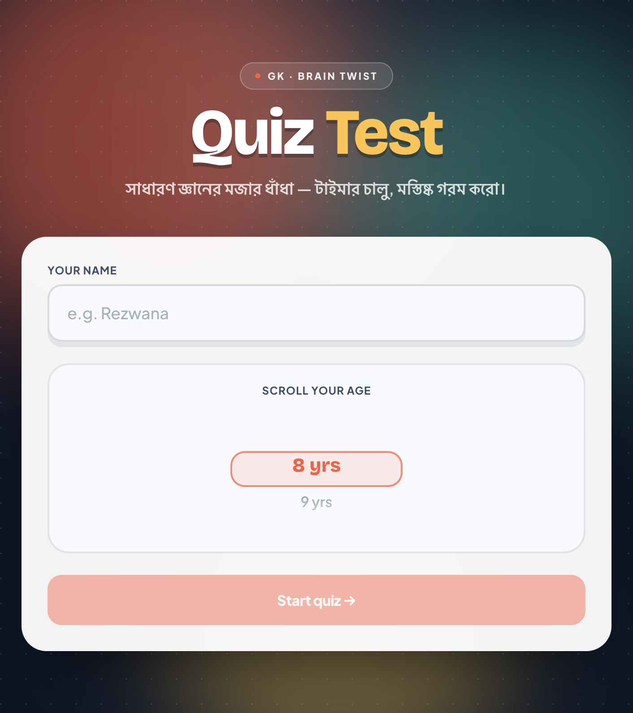
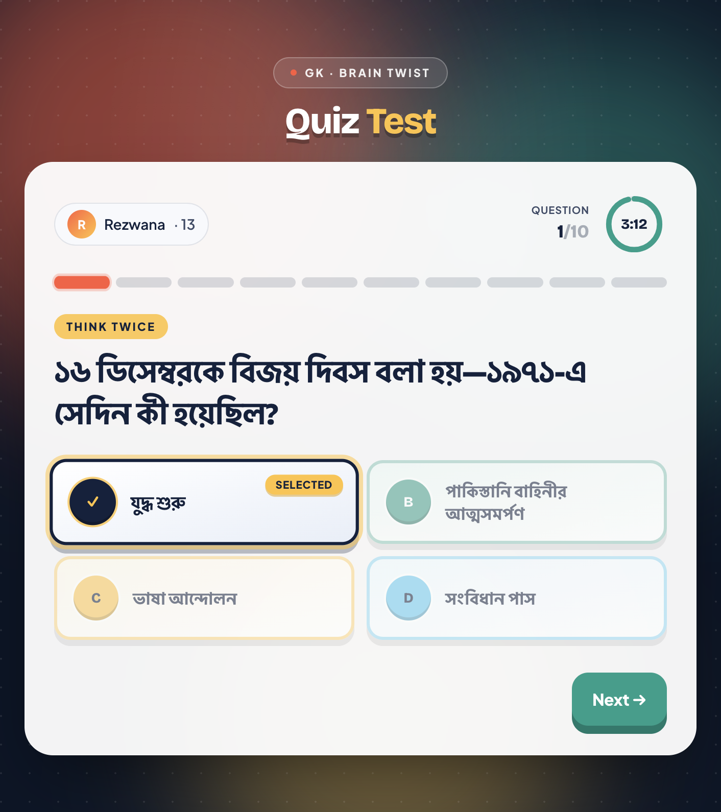
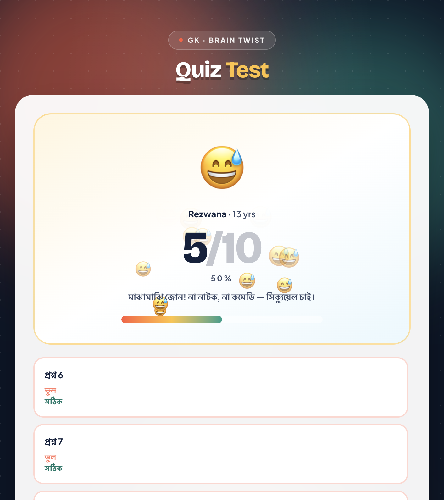

# Quiz Test — GK Brain Twist

Timed Bangla quiz app with curiosity GK, funny ধাঁধা, IQ/patterns, and math/geometry. Clear option select (no mid-quiz spoilers), Messenger-style scoreboard (one center emoji + same emoji floating), and clean browser navigation.

## Screenshots (current UI — Nov 2026)

> `docs/screenshots/` refreshed to match live app: **10 questions**, one middle emoji, Messenger-style float of that same emoji.

### 1. Start — front page



Name + age → Start quiz. Also the screen for refresh / Chrome Back.

### 2. Running — 10 questions



`1/10` timer, clear **Selected** option, in-quiz Back/Next only.

### 3. Winner — 10/10


One center 🏆; copies of the **same** 🏆 float across the card + funny comment.

### 4. High — 8/10 (≥70%)


One center 🔥; same 🔥 floats + funny comment + wrong-only review.

### 5. Mid — 5/10 (≥40%)



One center 😅; same 😅 floats + funny comment + wrong review.

### 6. Low — 2/10 (&lt;40%)


One center 😢; same 😢 floats + funny comment + wrong review.

## App states

| State | What you see |
| --- | --- |
| **Start** | Name + age form |
| **Running** | 10 questions, Selected highlight, no right/wrong leak |
| **Winner** | 10/10 · 🏆 · party density float of 🏆 only |
| **High** | 7–9/10 · 🔥 |
| **Mid** | 4–6/10 · 😅 |
| **Low** | 0–3/10 · 😢 |

Scoreboard always: name · age, X/10, %, funny comment (random per tier), progress bar, wrong-only review (hidden on perfect), Play again / Change player.

## Navigation

| Control | Behavior |
| --- | --- |
| Chrome / browser **Back** | Front page (name + age) |
| In-quiz **← Back** / **Next →** | Previous / next question |
| Refresh / new visit | Front page — no mid-quiz resume |
| Change player | Front page, cleared player |

## Features

- **10 questions / round**; timer ≈ 3:20 (`max(30, count × 20)`)  
- **250-question bank** — GK wow-facts, ধাঁধা, IQ/patterns, math/geometry  
- **No repeat** until bank exhausted (global + per-user `*_v2` keys)  
- Option **Selected** only mid-quiz; right/wrong on scoreboard  
- Storage `v4-nav` clears stale 5-question sessions  

## Stack

React 19 · React Router 7 · Vite · Tailwind CSS 4 · TypeScript  

## Run locally

```bash
npm install
npm run dev
```

Open [http://localhost:5173](http://localhost:5173).

## Scripts

| Command | Description |
| --- | --- |
| `npm run dev` | Development server |
| `npm run build` | Production build |
| `npm start` | Serve production build |
| `npm run typecheck` | Route types + TypeScript check |

## Project files

| Path | Role |
| --- | --- |
| `app/data/questions.json` | 250 questions |
| `app/routes/Quiz.tsx` | Flow, scoring, single-emoji FX, nav |
| `app/app.css` | Float animations |
| `docs/screenshots/01`–`06` | Current UI stills (updated) |
