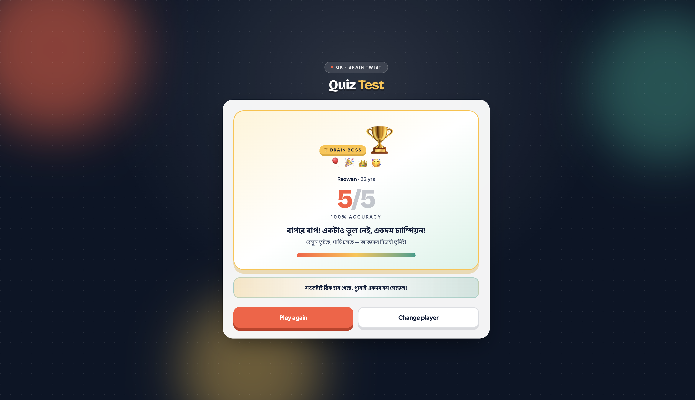
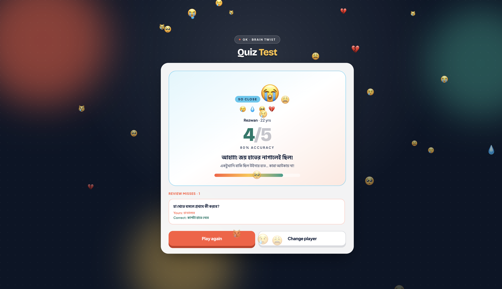
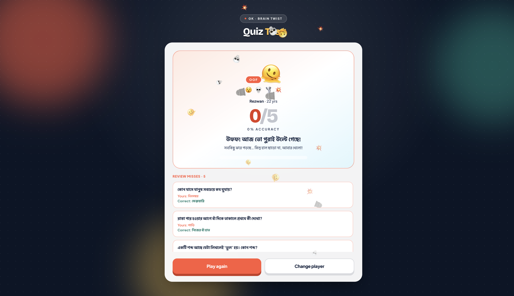

# Quiz Test — GK Brain Twist

A timed Bangla general-knowledge quiz with brain-twist riddles, funny score reactions, and a category-ready arena UI.

Built as a portfolio piece: lively enough to demo, clean enough to extend into multiple quiz categories later.

## Screenshots

### 1. Start


### 2. Running


### 3. Perfect — 10/10



### 4. High — 7–9/10 (≥70%)



### 5. Mid — 4–6/10 (≥40%)


### 6. Low — 0–3/10



## Features

- **Timed rounds** — 10 questions per round; timer scales with question count (~20s each, min 30s)
- **250-question bank** — easy / medium / hard mix (≈68 / 96 / 86): GK twist, ধাঁধা, IQ/patterns, math/geometry
- **No repeat until bank ends** — same or different users won’t see a used question again until all 250 are exhausted, then a new cycle starts (`quizSeenGlobal_v2` + `quizSeenByUser_v2`)
- **Clear option select** — selected answer gets a strong highlight + Selected badge (no right/wrong leak mid-quiz)
- **Results only reveal** — correct / wrong feedback appears on the final scoreboard; review lists wrong answers only
- **Score reactions** — rotating Bangla funny comments + floating emoji; full-card celebrate on a perfect 10/10
- **Local persistence** — quiz history + global/per-user seen IDs in `localStorage`
- **Category-ready shell** — shared night-arena layout so future categories can plug in

## Stack

- React 19
- React Router 7
- Vite
- Tailwind CSS 4
- TypeScript

## Run locally

```bash
npm install
npm run dev
```

Open [http://localhost:5173](http://localhost:5173).

## Scripts

| Command | Description |
| --- | --- |
| `npm run dev` | Start development server |
| `npm run build` | Production build |
| `npm start` | Serve production build |
| `npm run typecheck` | Generate route types + TypeScript check |

## Project notes

- Question bank: `app/data/questions.json` (250 unique items, ids 1–250)
- Main UI + game flow: `app/routes/Quiz.tsx` (`QUESTIONS_PER_ROUND = 10`, `SECONDS_PER_QUESTION = 20`)
- Shared button styles: `app/components/Button.tsx`
- Scoreboard FX styles: `app/app.css` (`.animate-emoji-float`, `.animate-emoji-float-party`)
- Screenshots: `docs/screenshots/01` → `06`

## How scoring works

| Result | Score | Reaction |
| --- | --- | --- |
| Perfect | 10/10 | 🏆 + party emoji float + winner comments |
| High | ≥70% (7–9) | 🔥 + floating emoji + near-miss comments |
| Mid | ≥40% (4–6) | 😅 + mid comments |
| Low | under 40% (0–3) | 😢 + fail comments |

## Recent updates

- Rounds are **10 questions**; timer = `max(30, count × 20)` seconds
- Question bank rebuilt to **250** curiosity-led items (GK wow-facts, funny ধাঁধা, IQ/patterns, math/geometry)
- **No repeats** across users until the full bank is used; recycle resets `quizSeenGlobal_v2` + per-user maps
- Option select is visually clear without mid-quiz right/wrong reveal
- Scoreboard: funny rotating comments + floating emoji (full-card celebrate on 10/10); wrong-only review
